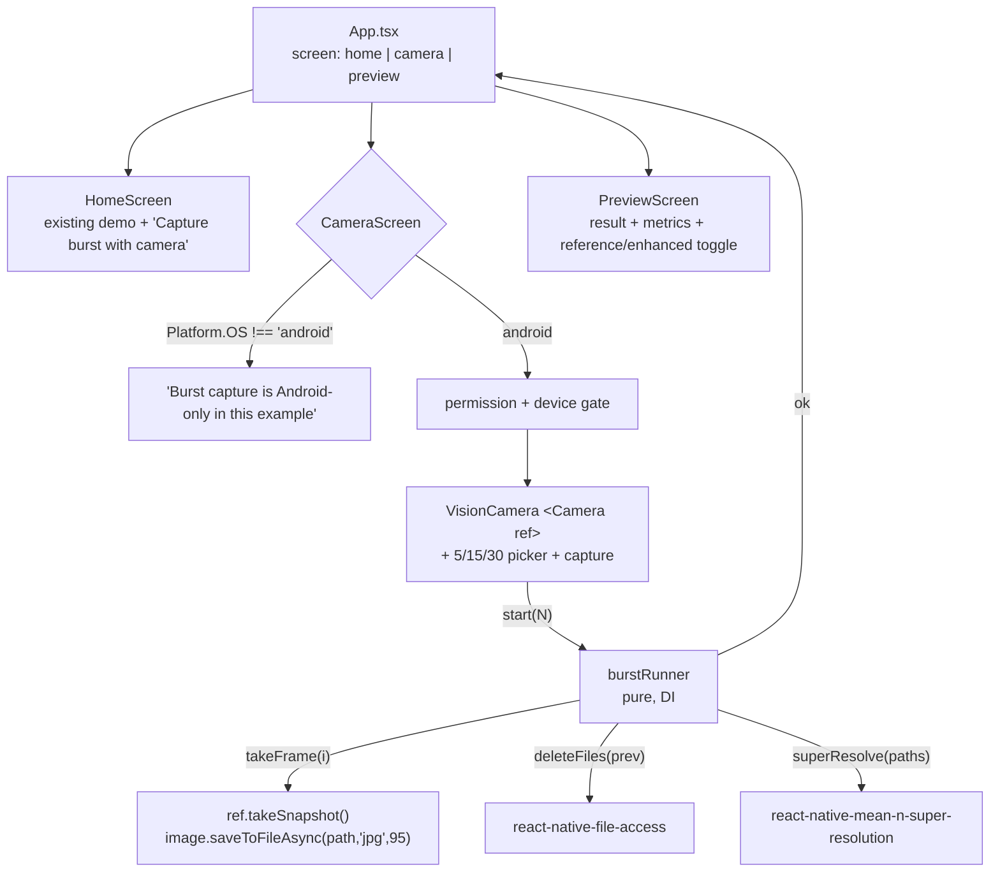

# example-camera-burst Design

**Spec**: `.specs/features/example-camera-burst/spec.md`
**Context**: `.specs/features/example-camera-burst/context.md`
**Status**: Approved (2026-11-12). Amended 2026-11-12: iOS out of scope (owner): no Info.plist changes, no iOS notice branch; CAM-16/CAM-19 deferred.

---

## Architecture Overview

Example-only change. `App.tsx` becomes a three-state screen switch. The existing demo moves to `HomeScreen` unchanged. Burst logic (capture loop, cleanup, `superResolve` call, single-run guard) lives in a pure, dependency-injected module, `burstRunner`, so Jest can test it without a camera. The camera screen only wires VisionCamera into that runner.



Flow: home → camera (idle) → capture: `capturing i/N` → `processing` → success → preview. A capture or process failure returns the camera screen to idle with an error. Back from preview → camera (idle). Back from camera (idle only) → home.

---

## Research Findings (Knowledge Verification Chain)

| Question | Finding | Source |
| --- | --- | --- |
| Version | `react-native-vision-camera@5.2.4` is latest (2026-10-29). v5 is Nitro-based; peers are `react-native-nitro-modules` (0.37.2) and `react-native-nitro-image` (0.15.2). v4 compatibility with RN 0.88 was **not checked**. | `npm view`, package.json in tarball |
| Snapshot API | `CameraRef.takeSnapshot(): Promise<Image>`. It throws `"Camera Preview is not yet ready!"` before the preview mounts. | `src/views/Camera.tsx:173`, `src/specs/views/PreviewView.nitro.ts:114` |
| iOS | `takeSnapshot()` is `@platform Android`; the Swift implementation throws `"takeSnapshot() is not available on iOS!"`. | `ios/Hybrid Objects/Views/HybridPreviewView.swift:123` |
| Android impl | `previewView.bitmap` from CameraX `PreviewView`, so snapshot pixel size = PreviewView size in px. Throws if the bitmap is null. | `HybridPreviewView.kt:129` |
| Snapshot to file | nitro-image `Image.saveToFileAsync(path, 'jpg', quality)`. The path is plain fs (no `file://`); the extension is not authoritative. | `react-native-nitro-image/src/specs/Image.nitro.ts:181` |
| Permission | `useCameraPermission()` returns `{status, hasPermission, canRequestPermission, requestPermission}` and re-reads on AppState `active`. Denied permanently = `!hasPermission && !canRequestPermission`. | `src/hooks/usePermission.ts` |
| Device | `useCameraDevice('back')`; `<Camera device isActive ref onPreviewStarted />`. | Context7 `/websites/visioncamera_margelo`, `Camera.tsx` |
| Lifetime | Nitro 0.37.2 `HybridObject` has no `dispose()`. Snapshot `Image`s are released by dropping references after save. | grep of nitro-modules src |
| Android build | VisionCamera uses CameraX `1.7.0-alpha03`, its own Kotlin default 2.2.21 (example has `kotlinVersion = "2.2.0"`), min SDK 23 (example 24), and NDK from app ext (30). | `android/build.gradle`, `gradle.properties` |
| Error text | Library rejections start with `E_CODE: `. | `src/errors.ts:1` |

---

## Code Reuse Analysis

| Component | Location | How to Use |
| --- | --- | --- |
| Existing demo (copy frames, run, checks, heartbeat) | `example/src/App.tsx` | Move verbatim into `HomeScreen`; only add the new button and an `onOpenCamera` prop. |
| `react-native-file-access` (`Dirs.CacheDir`, `FileSystem.exists/unlink`) | example dep | Snapshot dir + previous-burst cleanup. |
| `superResolve`, `SuperResolveResult` | `src/index.tsx` | Called as-is with default options (scale 2). |
| Result display (dims, framesUsed, image with aspectRatio) | `example/src/App.tsx` result block | Same pattern in `PreviewScreen`. |
| Root Jest config (`@react-native/jest-preset`, source condition) | `package.json` `jest` | Example unit tests under `example/src/**/__tests__` run in `yarn test`; no new Jest config. |

### Integration Points

| System | Integration Method |
| --- | --- |
| RN autolinking (Android) | Add the 3 deps to `example/package.json`; autolinking + Nitro generated code compile them. |
| Android manifest | `<uses-permission android:name="android.permission.CAMERA" />`, `android:screenOrientation="portrait"` on `MainActivity`. |
| iOS Info.plist | Add `NSCameraUsageDescription`; set `UISupportedInterfaceOrientations~ipad` to portrait only (iPhone is already portrait-only). |
| iOS Podfile | No change; pods are picked up by autolinking on `pod install` (unverified, no Mac). |

---

## Components

### burstRunner (pure)

- **Purpose**: Runs one burst: guard, cleanup, sequential capture, `superResolve`, outcome. No React, no native imports.
- **Location**: `example/src/burst/burstRunner.ts` (+ `example/src/burst/__tests__/burstRunner.test.ts`)
- **Interfaces**:
  - `createBurstRunner(deps: BurstDeps): BurstRunner`
  - `BurstRunner.start(count: FrameCount, onEvent: (e: BurstEvent) => void): Promise<BurstOutcome> | null`. Returns `null` synchronously when a burst is already running (CAM-13).
  - `BurstRunner.isRunning(): boolean`
- **Behavior**:
  1. Set running before any `await`.
  2. `deleteFiles(previousPaths)`. Delete errors are swallowed, so a failed cleanup never blocks the burst (CAM-14).
  3. For `i = 0..N-1`: `path = await takeFrame(i)`, push, then `onEvent({type:'progress', captured: i+1, total: N})` (CAM-04).
  4. Throw at step 3: record the partial paths as `previousPaths`, return `{ok:false, stage:'capture', message}`, and never call `superResolve` (CAM-11).
  5. `onEvent({type:'processing'})`, then `t0 = now()`, then `superResolve(paths)` in capture order (CAM-05).
  6. Resolve: return `{ok:true, run:{result, paths, requested:N, elapsedMs: now()-t0}}` (CAM-06). Reject: return `{ok:false, stage:'process', message}` with message = `Error.message` (starts with `E_*`) (CAM-10).
  7. Always: `previousPaths = paths`, running = false.
- **Dependencies**: injected only.
- **Reuses**: nothing; new.

### frameCounts

- **Location**: `example/src/burst/frameCounts.ts`
- **Interfaces**: `FRAME_COUNTS = [5, 15, 30] as const`, `type FrameCount = (typeof FRAME_COUNTS)[number]`, `DEFAULT_FRAME_COUNT: FrameCount = 5` (CAM-03).

### App (screen switch)

- **Location**: `example/src/App.tsx`
- **State**: `type Screen = {name:'home'} | {name:'camera'} | {name:'preview', run: CameraRun}`.
- **Transitions**: home→camera (`onOpenCamera`), camera→home (`onBack`), camera→preview (`onResult(run)`), preview→camera (`onBack`) (CAM-08).
- **Android hardware back**: `BackHandler` follows the same transitions and is ignored while the camera screen reports busy (CAM-13).

### HomeScreen

- **Location**: `example/src/screens/HomeScreen.tsx`
- **Interfaces**: `HomeScreen({ onOpenCamera }: { onOpenCamera: () => void })`
- **Content**: current `App.tsx` body unchanged, plus `<Button title="Capture burst with camera" onPress={onOpenCamera} disabled={busy} />` (CAM-01).

### CameraScreen

- **Location**: `example/src/screens/CameraScreen.tsx`
- **Interfaces**: `CameraScreen({ onBack, onResult, onBusyChange })`
- **Platform branch**: `Platform.OS !== 'android'` renders the notice "Burst capture is Android-only in this example" and Back. VisionCamera hooks are not called on that path (CAM-19).
- **Android render order**:
  1. `useCameraPermission()`. On mount, `requestPermission()` runs when `canRequestPermission`. When `!hasPermission && !canRequestPermission`, the screen shows "Camera permission denied" and an "Open settings" button (`Linking.openSettings()`), with no capture controls (CAM-09).
  2. `useCameraDevice('back')`. When it returns `undefined`, the screen shows "No camera available" (CAM-12).
  3. `<Camera ref device isActive={screen focused} style={fixed box} onPreviewStarted={() => setReady(true)} />`, plus the 5/15/30 picker, Capture (enabled only when `ready && !busy`), the status line (`i/N`, "Processing…"), and the error text (CAM-02..05).
- **takeFrame(i)**: `const img = await cameraRef.current.takeSnapshot(); const path = \`${Dirs.CacheDir}/burst-${burstId}-${i}.jpg\`; await img.saveToFileAsync(path, 'jpg', 95); return path`. `burstId = Date.now()` per burst gives unique file names, so the preview `<Image>` never shows a stale cached frame.
- **Busy**: derived from runner events. Picker, Capture and Back are disabled while busy, and `onBusyChange` feeds `App`'s BackHandler guard (CAM-13).
- **Unmount**: the runner keeps its own state. The screen ignores events after unmount (mounted ref), but unmount while busy cannot happen because Back is disabled.

### PreviewScreen

- **Location**: `example/src/screens/PreviewScreen.tsx`
- **Interfaces**: `PreviewScreen({ run, onBack }: { run: CameraRun; onBack: () => void })`
- **Content**: metrics `Output: W×H`, `framesUsed: k / N requested`, `Processing: X ms`, then a two-option toggle "Enhanced" / "Reference (frame 1)". The image shows `run.result.path` or `file://` + `run.paths[0]`, at the same width with `resizeMode="contain"` and the output aspect ratio, so the reference is shown scaled up for direct comparison (CAM-06, CAM-07).
- **Choice (agent discretion)**: toggle, not side-by-side. Portrait width makes side-by-side images too small to compare detail.

---

## Data Models

```typescript
// example/src/burst/types.ts
import type { SuperResolveResult } from 'react-native-mean-n-super-resolution';
import type { FrameCount } from './frameCounts';

export type CameraRun = {
  result: SuperResolveResult;
  paths: string[];        // capture order, paths[0] = reference
  requested: FrameCount;
  elapsedMs: number;      // superResolve only, excludes capture
};

export type BurstEvent =
  | { type: 'progress'; captured: number; total: FrameCount }
  | { type: 'processing' };

export type BurstOutcome =
  | { ok: true; run: CameraRun }
  | { ok: false; stage: 'capture' | 'process'; message: string };

export type BurstDeps = {
  takeFrame: (index: number) => Promise<string>;
  deleteFiles: (paths: string[]) => Promise<void>;
  superResolve: (paths: string[]) => Promise<SuperResolveResult>;
  now: () => number;
};
```

---

## Error Handling Strategy

| Error Scenario | Handling | User Impact |
| --- | --- | --- |
| Permission not determined | `requestPermission()` on mount | System dialog |
| Permission denied (permanent) | No `<Camera>`; settings button | "Camera permission denied" + "Open settings" (CAM-09) |
| No back camera | No `<Camera>` | "No camera available" (CAM-12) |
| Capture tapped before preview ready | Capture disabled until `onPreviewStarted` | Button greyed out |
| `takeSnapshot`/`saveToFileAsync` throws | Runner `stage:'capture'`, no `superResolve` | "Capture failed: <message>", idle, retry possible (CAM-11) |
| `superResolve` rejects | Runner `stage:'process'` | Error text with `E_*` code, preview not opened (CAM-10) |
| Cleanup of previous files fails | Swallowed + `console.log` | None |
| Double tap on Capture | `start()` returns `null` synchronously | One burst only (CAM-13) |
| iOS | Notice screen, camera never mounted | "Burst capture is Android-only in this example" (CAM-19) |

---

## Test Strategy

| Layer | What | Covers |
| --- | --- | --- |
| Jest unit (`yarn test`) | `burstRunner` with fake deps: N frames in order, progress events `1..N`, `superResolve` args equal capture order, success outcome fields, capture failure at frame k (no `superResolve`, stage `capture`), process rejection (message passthrough with `E_` code), second `start` during run returns `null` with no extra `takeFrame`, previous paths deleted before the next burst's first `takeFrame`, delete failure does not block | CAM-04, 05, 06 (data), 10, 11, 13, 14 |
| Jest unit | `FRAME_COUNTS` equals `[5,15,30]`, default 5 | CAM-03 |
| Static (grep in validation) | Manifest CAMERA + portrait, Info.plist `NSCameraUsageDescription` + iPad portrait | CAM-15 (manifest part), 16, 18 |
| Build | `yarn turbo run build:android` | CAM-15 |
| Repo gates | `yarn lint`, `yarn typecheck`, `yarn test` | CAM-17 |
| Android device UAT | 5/15/30 bursts reach preview (screenshots + `[camera-burst]` log line with W×H, framesUsed, N, ms); toggle; back nav; permission denied; forced rejection; rotation stays portrait; existing demo still outputs 1280×960 | CAM-01, 02, 06, 07, 08, 09, 10, 12*, 18 |

\* CAM-12 cannot be produced on a phone with a camera. The evidence is a code review of the `device === undefined` branch, logged as a gap.

No React component tests: the repo has no `@testing-library/react-native`, and adding it is outside this feature. Screen behavior is verified by UAT.

---

## Risks & Concerns

| Concern | Location (file:line) | Impact | Mitigation |
| --- | --- | --- | --- |
| Snapshot size = PreviewView px size. If the layout of the camera box changes mid-burst (status text reflow), frames differ and `E_SIZE_MISMATCH` follows | `CameraScreen` layout | Burst fails | Camera in a fixed-size box (`aspectRatio` 3/4, full width); status/error text outside it with reserved height. Portrait lock (CAM-18). |
| Kotlin mismatch: example `kotlinVersion = "2.2.0"`, VisionCamera default 2.2.21, Nitro 2.1.21 | `example/android/build.gradle:8` | Android compile failure | Build task runs first. If it fails, bump the example `kotlinVersion` and record the reason. |
| CameraX `1.7.0-alpha03` (alpha) bundled by VisionCamera | VisionCamera `android/build.gradle:146` | Device-specific camera bugs | Accepted for an example app; pin the exact `5.2.4` (no caret). |
| RN 0.88 + Nitro 0.37 + Windows path bug (backslashes in `Android-autolinking.cmake`) may also hit Nitro's CMake | `example/android/app/build.gradle` workaround | Build failure on Windows | Build task verifies; extend the existing workaround if needed. |
| Memory: 30 snapshots, each about 1080×1440×4 B ≈ 6 MB bitmap | runner loop | GC pressure | Save each immediately and keep no `Image` refs (no `dispose()` in Nitro 0.37). Library memory budget depends only on frame size: 2²×1080×1440×15 ≈ 93 MB, well under 1 GiB. |
| Snapshots are the *displayed* preview (display-scaled, possibly letterbox per `resizeMode`), not sensor frames | spec decision | Lower SR quality | Owner-accepted (context.md). `resizeMode="cover"` keeps frames free of black bars. |
| `App.tsx` move risks breaking the existing demo or checks (SR UAT evidence from the previous feature) | `example/src/App.tsx` | Regression | Move code verbatim. UAT re-runs the 5-frame demo (expects 1280×960). |
| iOS: pods for VisionCamera/Nitro never built here (no Mac); CI `build-ios` is the only signal | `example/ios` | iOS build break unknown | Logged gap; CI build-ios once pushed. |
| Test gap: screens untested by automation | `example/src/screens/*` | UI regressions only caught by UAT | Keep screens thin; logic in `burstRunner` (unit tested). |

---

## Tech Decisions

| Decision | Choice | Rationale |
| --- | --- | --- |
| Camera lib version | `react-native-vision-camera@5.2.4`, `react-native-nitro-modules@0.37.2`, `react-native-nitro-image@0.15.2`, exact pins | Latest. Snapshot API verified in source. |
| Platform scope | Android-only camera; iOS notice | Owner decision; iOS snapshot throws |
| Logic placement | Pure DI `burstRunner` | Only part testable without a device |
| Frame format | JPEG q95 in `Dirs.CacheDir`, `burst-<id>-<i>.jpg` | Small files, fast write; unique names avoid `<Image>` cache staleness |
| Busy guard | Synchronous flag inside runner + disabled UI | `setState` is async, so a UI-only guard can double-fire |
| Preview compare | Toggle Enhanced/Reference | Portrait width |

No project-level `AD-NNN`: all decisions are example-local. Conforms to AD-001..005 (no library/native changes; NDK r30 kept).
