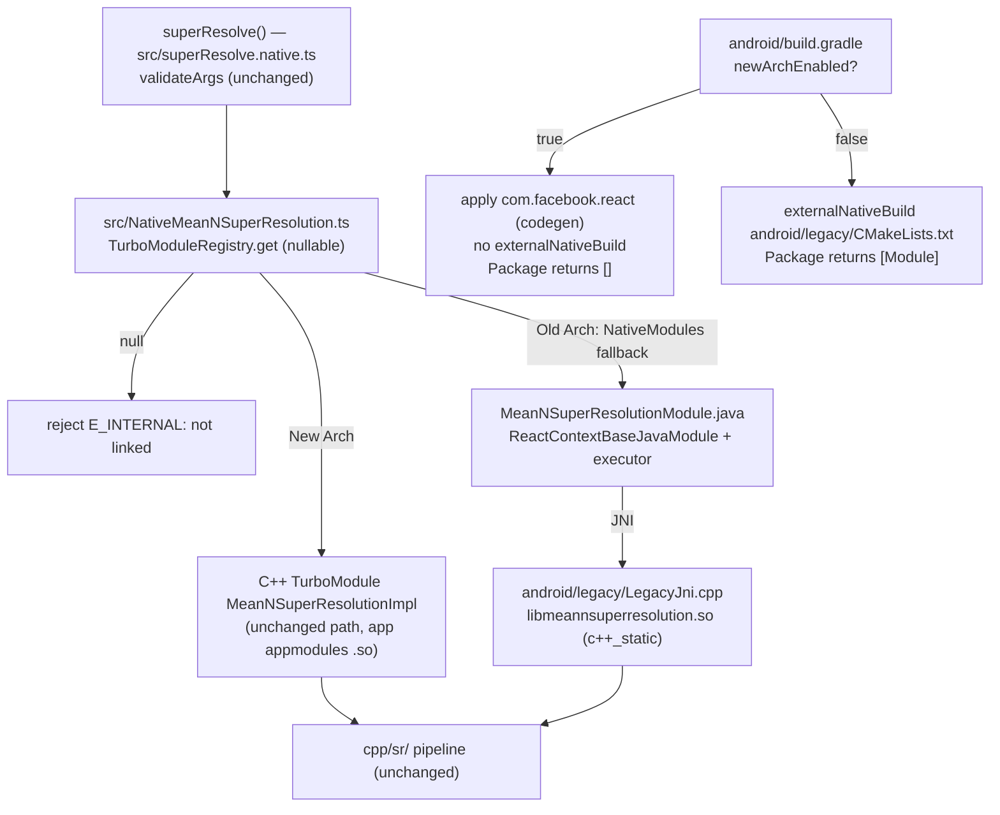

# legacy-arch-android Design

**Spec**: `.specs/features/legacy-arch-android/spec.md`
**Context**: `.specs/features/legacy-arch-android/context.md`
**Status**: Approved (2026-11-15)

Approach **A — dual-arch Gradle module** chosen by owner (2026-11-15) over B (dynamic `react-native.config.js`). `example-legacy/` is standalone and consumes a `yarn pack` tarball (owner, 2026-11-15).

---

## Research Findings (evidence)

| Fact | Source |
| ---- | ------ |
| RN 0.72.17 template: Gradle 8.0.1, AGP 7.4.2, minSdk 21, compileSdk 33, NDK 23.1, `newArchEnabled=false`, Java template (no Kotlin plugin) | `npm pack react-native@0.72` → `template/android/*`; `@react-native/gradle-plugin@0.72.11` `build.gradle.kts:36` |
| NDK r30 supports minSdk 21 (`"min": 21`) | `$ANDROID_HOME/ndk/30.0.14904198/meta/platforms.json` (local install is `r30-beta1`) |
| RN 0.72 `TurboModuleRegistry.get/getEnforcing` returns `NativeModules[name]` first when not bridgeless | `react-native@0.72.17` `Libraries/TurboModule/TurboModuleRegistry.js` |
| RN 0.72 `PromiseImpl.reject(code, message)` puts `code` and `message` on the JS error | `ReactAndroid/.../bridge/PromiseImpl.java:69,183,188` |
| Autolinking treats the lib as pure C++ **only while `android/build.gradle` and a manifest are absent**; with a Gradle module it uses `packageImportPath` + codegen `cmakeListsPath` (`android/build/generated/source/codegen/jni/CMakeLists.txt`) and still emits the `cxxModuleHeaderName` provider | `example/node_modules/@react-native-community/cli-config-android/build/config/index.js:112-159`; `@react-native/gradle-plugin` `GenerateAutolinkingNewArchitecturesFileTask.kt:104-170` |
| CMake in this repo needs ≥ 3.19; AGP 7.4 default CMake is older | `cmake/OpenCVMobile.cmake:4`, `android/CMakeLists.txt:1` |

---

## Architecture Overview

Build-time switch: Gradle property `newArchEnabled` (same property RN reads, so `-PnewArchEnabled` works). Runtime switch: `TurboModuleRegistry.get` already returns the Bridge module on Old Arch.

---

## Code Reuse Analysis

### Existing Components to Leverage

| Component | Location | How to Use |
| --------- | -------- | ---------- |
| Pipeline `sr::run`, `sr::Request/Result` | `cpp/sr/Pipeline.h` | Called by JNI adapter exactly like `MeanNSuperResolutionImpl` |
| Error formatting `sr::toRejectMessage` | `cpp/sr/ErrorMapping.h` | Same `"E_CODE: detail"` string on legacy (LEG-04) |
| `toScale` conversion | `cpp/MeanNSuperResolutionImpl.cpp:17-22` | Move to `cpp/sr/Scale.h` so both adapters share it |
| NDK r30 fail-fast block | `android/CMakeLists.txt:4-19` | Move to `cmake/RequireNdk.cmake`, included by both CMake files (LEG-14) |
| OpenCV fetch `opencv_mobile_find_package(android)` | `cmake/OpenCVMobile.cmake` | Reused by legacy CMake |
| JS validation | `src/validate.ts` | Unchanged; runs before native on both archs (LEG-05) |
| Frame copy from bundled assets | `example/src/screens/HomeScreen.tsx:30-50`, `example/assets/frames/` | Same flow and same 5 PNGs in `example-legacy/` (LEG-03 parity) |
| Windows AVD workarounds | project memory `android-avd-uat-workarounds` | UAT on emulator |

### Integration Points

| System | Integration Method |
| ------ | ------------------ |
| RN autolinking (0.72 CLI 11 and 0.88 CLI 20) | `android/build.gradle` + `react-native.config.js` explicit `packageImportPath` / `packageInstance` (avoids namespace-detection differences between CLI versions) |
| New Arch app CMake | Codegen `cmakeListsPath` (default) + existing `cxxModuleCMakeListsPath: CMakeLists.txt` |
| Old Arch app | AAR with `libmeannsuperresolution.so` + Java classes; no app CMake |

---

## Components

### JS registry + not-linked error (LEG-11)

- **Location**: `src/NativeMeanNSuperResolution.ts`, `src/superResolve.native.ts`, `src/errors.ts`
- **Interfaces**: `export default TurboModuleRegistry.get<Spec>('MeanNSuperResolution')` (type `Spec | null`); `superResolve` rejects `new Error('E_INTERNAL: native module MeanNSuperResolution is not linked; rebuild the app (iOS requires the New Architecture)')` when null, after `validateArgs`.
- **Reuses**: existing wrapper; codegen accepts `get` as well as `getEnforcing`.

### Shared scale conversion

- **Location**: `cpp/sr/Scale.h` (header-only, JSI-free) + host test `cpp/tests/scale_test.cpp`
- **Interfaces**: `int sr::toScale(std::optional<double>)` — identical semantics to current anonymous-namespace function.

### Legacy JNI adapter

- **Location**: `android/legacy/LegacyJni.cpp`, `android/legacy/TempDirLegacy.cpp`, `android/legacy/CMakeLists.txt`
- **Interfaces**:
  - `jobject Java_com_meannsuperresolution_MeanNSuperResolutionNative_nativeSuperResolve(JNIEnv*, jclass, jobjectArray paths, jboolean hasScale, jdouble scale, jstring outputPath, jstring cacheDir)` → returns `com.meannsuperresolution.SuperResolveResult(String path, int width, int height, int framesUsed)`; on any C++ exception throws `com.meannsuperresolution.SuperResolveException(sr::toRejectMessage(...))` via `ThrowNew`. Synchronous; caller provides the thread.
  - `TempDirLegacy.cpp` implements `sr::platform::defaultOutputDir()`: `TMPDIR` if writable, else the `cacheDir` passed into the current call (thread-local, set and cleared by the JNI entry, so never cached across calls), else `SrError(E_WRITE_FAILED, "no writable temp dir; pass options.outputPath")` — same rule and message as `android/src/TempDir.cpp`.
- **Build**: SHARED lib `meannsuperresolution`, `ANDROID_STL=c++_static`, C++20, `-fexceptions -frtti`, links only OpenCV + `log`; exported symbols limited to `Java_*`/`JNI_*` (version script) and `-Wl,--exclude-libs,ALL`.
- **Why no fbjni / no RN prefab**: static libc++ avoids picking RN 0.72's NDK-23 `libc++_shared.so` (lacks symbols opencv-mobile v38 needs, AD-005); passing `std::string` through fbjni with a second libc++ copy would be UB, so the cache dir comes from Java instead.

### Java module + package (Java, not Kotlin)

- **Location**: `android/src/main/java/com/meannsuperresolution/` — `MeanNSuperResolutionModule.java`, `MeanNSuperResolutionPackage.java`, `MeanNSuperResolutionNative.java`, `SuperResolveResult.java`, `SuperResolveException.java`; `android/src/main/AndroidManifest.xml` (no `package` attr)
- **Interfaces**:
  - Module `getName()` = `"MeanNSuperResolution"`; `@ReactMethod superResolve(ReadableArray paths, ReadableMap options, Promise promise)`.
  - Converts args (`scale` only if key present and not null; `outputPath` likewise); conversion failure → reject `E_INVALID_ARGUMENT`.
  - Submits to a module-owned `Executors.newCachedThreadPool()` (off JS and UI threads, concurrent calls run in parallel — LEG-06/07).
  - On `SuperResolveException`: `promise.reject(code, message)` with `code` = prefix before `": "` (LEG-04). Other `Throwable` (incl. `UnsatisfiedLinkError` from lazy `System.loadLibrary`) → `reject("E_INTERNAL", "E_INTERNAL: " + detail)`.
  - Success → `WritableMap {path, width, height, framesUsed}`.
  - `invalidate()` sets an `AtomicBoolean`; completed jobs check it and skip settling; executor `shutdown()` (running native work finishes, cannot be interrupted) (LEG-15).
  - Package `createNativeModules` returns `[Module]` only when `BuildConfig.IS_NEW_ARCHITECTURE_ENABLED == false`, else `[]` (LEG-08).
- **Dependencies**: `com.facebook.react:react-native:+` (`compileOnly`-style via `implementation`, substituted by RN plugin).

### Gradle module

- **Location**: `android/build.gradle`
- **Behavior**: `com.android.library`; `namespace "com.meannsuperresolution"`; SDK/NDK versions from `rootProject.ext` with safe defaults; `buildConfigField IS_NEW_ARCHITECTURE_ENABLED`.
  - New Arch: `apply plugin: "com.facebook.react"`; `react { jsRootDir = file("../src"); libraryName = "MeanNSuperResolutionSpec"; codegenJavaPackageName = "com.meannsuperresolution" }`; no `externalNativeBuild`.
  - Old Arch: `externalNativeBuild.cmake { path "legacy/CMakeLists.txt"; version "3.22.1" }`; `abiFilters` from `reactNativeArchitectures`.
- **Excluded from npm**: `android/build`, `android/.cxx` (add `!android/.cxx` to `files`).

### example-legacy app

- **Location**: `example-legacy/` (not a Yarn workspace; own lockfile; ignored by root eslint/tsc/jest)
- **Content**: RN 0.72.17 template (Java), `newArchEnabled=false`, `ndkVersion "30.0.14904198"`, `react-native-file-access` 3.x (Old-Arch compatible), one screen: copy the 5 bundled frames (same PNGs as `example/assets/frames`), run 5- and 15-frame jobs, show `{width,height,framesUsed}` + image, "missing frame" button (LEG-04), "2 concurrent" button (LEG-07).
- **Lib install**: `scripts/pack-legacy-example.mjs` → `yarn prepare && yarn pack` → `example-legacy` installs `file:../react-native-mean-n-super-resolution.tgz`.

### CI

- New job `build-android-legacy` in `.github/workflows/ci.yml`: JDK 17, NDK r30, pack lib, install `example-legacy`, `./gradlew assembleDebug`. Existing jobs unchanged.

---

## Error Handling Strategy

| Error Scenario | Handling | User Impact |
| -------------- | -------- | ----------- |
| Invalid args | `validateArgs` in JS (unchanged) | `E_INVALID_ARGUMENT: ...` before native |
| Pipeline `SrError` / `bad_alloc` / other C++ | `toRejectMessage` → Java exception → `reject(code, message)` | Same message as New Arch; `error.code` set |
| `.so` fails to load | Caught on first call | `E_INTERNAL: native library meannsuperresolution failed to load: ...` |
| Module not linked (iOS Old Arch, not rebuilt) | `get()` returns null | `E_INTERNAL: native module ... not linked ...` |
| React reload mid-job | `invalidate()` flag; result dropped | No crash; stale promise never settles on dead context |
| NDK < r30 | `cmake/RequireNdk.cmake` FATAL_ERROR | Same AD-005 message |

---

## Risks & Concerns

| Concern | Location (file:line) | Impact | Mitigation |
| ------- | -------------------- | ------ | ---------- |
| AGP 7.4.2 + NDK r30 + opencv-mobile v38 never tried together; r30 installed locally is beta1 | `android/CMakeLists.txt:4-19` | Feature blocked (AD-005 re-open) | **Phase 0 spike (go/no-go)**: build legacy `.so` in `example-legacy` and `System.loadLibrary` on emulator before any other task |
| Adding `android/build.gradle` flips New Arch from pure-C++ to codegen autolinking | `cli-config-android/build/config/index.js:112` | New Arch regression (LEG-08/10) | Explicit regression task: example 0.88 Android build + UAT burst; check C++ provider wins and `MeanNSuperResolution` is the C++ module (no duplicate registration) |
| Codegen'd Java spec unused in New Arch; Java TurboModule provider vs C++ provider precedence | `GenerateAutolinkingNewArchitecturesFileTask.kt` | Wrong module served | Package returns `[]` on New Arch so no Java module exists; verified in regression task |
| RN 0.88 Windows backslash bug in autolinking CMake may also hit codegen `cmakeListsPath` | `example/android/app/build.gradle:122` | Windows New Arch build break | Covered by existing workaround; verify in regression task |
| `toScale` moves out of Impl | `cpp/MeanNSuperResolutionImpl.cpp:17-22` | Behavior drift | Host test pins all current cases before/after move |
| `TempDirLegacy` duplicates TMPDIR/cache rule of `android/src/TempDir.cpp` | `android/src/TempDir.cpp:59-72` | Drift between archs | Same message constant; noted as invariant comment in both |
| Java side has no automated unit tests | `android/src/main/java/...` | Logic regressions only caught in UAT | Keep Java logic minimal (arg conversion, code prefix); code-prefix parsing covered by emulator UAT cases (missing frame) |

---

## Tech Decisions

| Decision | Choice | Rationale |
| -------- | ------ | --------- |
| Adapter language | Java | RN 0.72 template has no Kotlin plugin; Java avoids forcing Kotlin on consumers |
| Legacy STL | `c++_static`, no fbjni | Avoid RN 0.72's older `libc++_shared.so` and cross-libc++ `std::string` |
| Cache dir on legacy | Passed from Java per call | No hidden `ActivityThread` API, no fbjni |
| Autolinking | Explicit `packageImportPath`/`packageInstance` | CLI 11 vs 20 namespace detection differences |
| `TurboModuleRegistry.get` vs `getEnforcing` | `get` | Import must not throw; enables LEG-11 |

**Project-level decisions (to append to STATE.md on approval):**
- AD-001 amended: shared C++ remains the only implementation; Android Old-Arch Java + JNI adapter allowed.
- AD-006: Dual-arch Android via Gradle module switched by `newArchEnabled`; legacy `.so` uses `c++_static`, no RN/fbjni native deps; iOS stays New Arch only.
