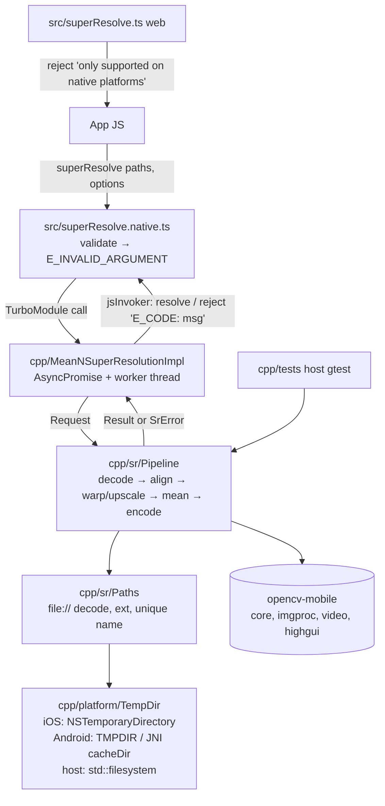

# opencv-super-resolution Design

**Spec**: `.specs/features/opencv-super-resolution/spec.md`
**Context**: `.specs/features/opencv-super-resolution/context.md`
**Status**: Approved
**Conforms to**: AD-001 (pure C++ TurboModule). Adds AD-002, AD-003.

---

## Architecture Overview

Three layers. JS validates arguments and calls the TurboModule. The TurboModule creates a Promise, hands the work to a worker thread and settles the Promise through the `CallInvoker`. The pipeline is plain C++ plus OpenCV and has no JSI, so it can be tested on a desktop machine.



### Pipeline algorithm (SR-CORE-02..04, SR-CFG-01)

For N frames, reference `R = frame[0]`, scale `s`:

1. **Decode** each path with `cv::imread(p, IMREAD_COLOR)`, which always gives 8-bit BGR (grayscale and alpha are converted, EXIF orientation is applied). If the result is empty → `E_DECODE_FAILED index=i`. If its size differs from R → `E_SIZE_MISMATCH index=i`.
2. **Estimate motion** of frame i to R on grayscale, downscaled so the long side is at most 1024 px (factor `d`):
   - Initial guess: `cv::phaseCorrelate` for the translation.
   - Refine with `cv::findTransformECC(MOTION_EUCLIDEAN, criteria COUNT|EPS 50 / 1e-4, gaussFiltSize 5)`.
   - Then scale the translation back by `1/d`.
   - Failure: if ECC throws or reports correlation < `0.85` → frame skipped (SR-ERR-06). R is never skipped.
3. **Warp + upscale in one interpolation**: `cv::warpAffine(frame_i, out, S·A_i, (s·w, s·h), INTER_CUBIC, BORDER_REPLICATE)`, with `S = diag(s, s)` and `A_i` the 2×3 transform from frame i to R. R uses `S·I`, so identical inputs go through exactly the same operation, which makes SR-CORE-03 hold by construction.
4. **Mean**: accumulate into `CV_32FC3` in index order, divide by `framesUsed`, convert to `CV_8UC3` with rounding. If `framesUsed < 2` → `E_ALIGNMENT_FAILED`.
5. **Encode** with `cv::imwrite`:
   - `.jpg`/`.jpeg` → `IMWRITE_JPEG_QUALITY 95`; `.png` → default.
   - If `imwrite` returns false or throws → `E_WRITE_FAILED`.

Pixels the warp leaves uncovered are filled with replicated borders, so the output stays defined. SR-CORE-04's PSNR is measured only in the region every frame covers (spec).

---

## Code Reuse Analysis

### Existing Components to Leverage

| Component | Location | How to Use |
| --------- | -------- | ---------- |
| Codegen spec pattern | `src/NativeMeanNSuperResolution.ts` | Replace `multiply` with `superResolve`; keep `TurboModuleRegistry.getEnforcing` |
| `.native.tsx` / `.tsx` split | `src/multiply.native.tsx`, `src/multiply.tsx` | Same pattern for `superResolve` (native impl / web reject); delete multiply files |
| C++ spec subclass | `cpp/MeanNSuperResolutionImpl.{h,cpp}` | Keep class + registration; swap method |
| iOS registration | `ios/OnLoad.mm` | Unchanged |
| Android autolinking | `react-native.config.js`, `android/CMakeLists.txt` | Extend CMake: new sources, OpenCV, fbjni |
| `AsyncPromise<T>` | `node_modules/react-native/ReactCommon/react/bridging/Promise.h` | Thread-safe resolve/reject that dispatches via `CallInvoker` (verified in source: mutex-guarded `AsyncCallback`) |
| Jest config | `package.json` `jest` | Already resolves `src` via source export condition; add tests in `src/__tests__/` |
| Turbo cache inputs | `turbo.json` | Add `opencv.json` to build inputs |

### Integration Points

| System | Integration Method |
| ------ | ------------------ |
| React Native codegen | Typed object aliases in Spec → generated `NativeMeanNSuperResolution…` structs + `Bridging<>` in `MeanNSuperResolutionSpecJSI.h` (exact generated names confirmed in T-task after first codegen run) |
| Android app build | Library CMake is pulled into app `appmodules` by autolinking. OpenCV is fetched and found inside that CMake run, so the consumer adds no Gradle deps |
| CocoaPods | Podspec downloads the opencv-mobile Apple package at spec evaluation and vendors `opencv2.xcframework` |
| CI | `ci.yml`: add `test-native` job (host gtest); existing build-android/ios exercise real linking |

---

## Components

### JS API — `src/superResolve.native.ts`, `src/superResolve.ts`, `src/types.ts`, `src/errors.ts`

- **Purpose**: Public typed API; argument validation; web fallback.
- **Interfaces**:
  - `superResolve(paths: string[], options?: SuperResolveOptions): Promise<SuperResolveResult>`
  - `ErrorCodes` const map (`E_INVALID_ARGUMENT`, …) exported for callers to match `error.message.startsWith(code)`.
  - `validateArgs(paths, options): string | null`: pure function that returns an error message or null. Used by the native wrapper and tested directly.
- **Rules**: `paths` is an array of non-empty strings with `length ∈ {5,15,30}`; `scale` is undefined or one of `{1,2,3,4}`; `outputPath` is undefined or a non-empty string whose lowercase extension is one of `.jpg`/`.jpeg`/`.png`. Any violation returns `Promise.reject(new Error('E_INVALID_ARGUMENT: …'))` and the native code is not called (SR-ERR-01..03).
- **Web**: `superResolve` returns `Promise.reject(new Error("'react-native-mean-n-super-resolution' is only supported on native platforms."))` (SR-ERR-09).
- **Reuses**: existing split-file pattern.

### TurboModule Spec — `src/NativeMeanNSuperResolution.ts`

```ts
export type SuperResolveOptions = { scale?: number; outputPath?: string };
export type SuperResolveResult = { path: string; width: number; height: number; framesUsed: number };
export interface Spec extends TurboModule {
  superResolve(paths: string[], options: SuperResolveOptions): Promise<SuperResolveResult>;
}
```

`options` is required at the native boundary; the JS wrapper passes `{}` when the caller gives none. This avoids an optional-object codegen edge case.

### TurboModule Impl — `cpp/MeanNSuperResolutionImpl.{h,cpp}`

- **Purpose**: Bridge JSI ↔ pipeline; async execution; error mapping.
- **Interface**: `AsyncPromise<SuperResolveResultStruct> superResolve(jsi::Runtime&, std::vector<std::string> paths, OptionsStruct options)` (types = codegen-generated).
- **Behavior**:
  1. Build `sr::Request` on the JS thread (cheap copy).
  2. Create `AsyncPromise` with `jsInvoker_`.
  3. Start a detached `std::thread` that captures the request and promise by value, never `this`.
  4. The worker runs `sr::run(request)` inside `try`:
     - `sr::SrError e` → `reject(Error(e.code + ": " + e.message))`
     - `cv::Exception`, `std::bad_alloc`, `std::exception`, or `...` → `E_INTERNAL: …` (SR-ERR-08)
     - otherwise `resolve(result)`.
- **Concurrency**: each call gets its own thread and state, with no shared mutable state (SR-CORE-07). Detached threads are acceptable for v1 (no cancellation; out of scope).

### Pipeline — `cpp/sr/Pipeline.{h,cpp}`, `cpp/sr/Errors.h`

- **Purpose**: Platform-agnostic super-resolution (algorithm above). No JSI or RN headers (AD-003).
- **Interfaces**:
  - `struct Request { std::vector<std::string> paths; int scale = 2; std::optional<std::string> outputPath; std::string defaultOutputDir; }`
  - `struct Result { std::string path; int width; int height; int framesUsed; }` (`path` is a `file://` URI)
  - `Result run(const Request&)`, which throws `SrError{ std::string code; std::string message; }`
  - `void validate(const Request&)` re-checks JS rules (frame count, scale, extension) → `E_INVALID_ARGUMENT`.
  - Internal, exposed in header for tests: `cv::Mat estimateTransform(const cv::Mat& refGray, const cv::Mat& gray, bool& ok)`.
- **Dependencies**: OpenCV `core`, `imgproc` (phaseCorrelate, warpAffine, cvtColor, resize), `video` (findTransformECC), and image read/write (`highgui` in opencv-mobile; `imgcodecs` in stock OpenCV).

### Paths — `cpp/sr/Paths.{h,cpp}`

- `std::string toFsPath(const std::string& pathOrUri)`: strips `file://`, percent-decodes, rejects other schemes → `E_INVALID_ARGUMENT`.
- `std::string toFileUri(const std::string& fsPath)`: builds the URI.
- `std::string lowerExt(const std::string&)`.
- `std::string uniqueOutputPath(const std::string& dir)`: `dir/superres-<epoch_ms>-<atomic counter>-<pid-or-random>.jpg`, unique across concurrent calls in one process (SR-CORE-07).

### TempDir — `cpp/platform/TempDir.h` + per-platform impl

- `std::string defaultOutputDir()`, resolved per call and not cached, so tests can override it.
  - **iOS** `ios/TempDir.mm`: `NSTemporaryDirectory()`.
  - **Android** `android/src/TempDir.cpp`: `getenv("TMPDIR")` if it is set and `access(W_OK)` passes. Otherwise call `ActivityThread.currentApplication().getCacheDir().getAbsolutePath()` through fbjni. If both fail → `E_WRITE_FAILED: no writable temp dir; pass options.outputPath`.
  - **Host tests** `cpp/tests/TempDirHost.cpp`: `std::filesystem::temp_directory_path()`.

### OpenCV distribution — `opencv.json`, `android/CMakeLists.txt`, `MeanNSuperResolution.podspec`

- **`opencv.json`** (repo root, shipped in npm `files`) is the single source for the pinned opencv-mobile version, plus `{url, sha256}` for the `android`, `apple` and host (`linux`, `windows`, `macos`) packages.
- **Android CMake**:
  - Read `opencv.json` with `string(JSON)` (CMake ≥ 3.19; RN's NDK CMake is newer).
  - Under `file(LOCK)`, because ABIs configure in parallel, use `file(DOWNLOAD … EXPECTED_HASH SHA256=…)` into `${CMAKE_CURRENT_LIST_DIR}/../.opencv/<version>/android` and extract.
  - `find_package(OpenCV REQUIRED PATHS <sdk>/native/jni NO_DEFAULT_PATH NO_CMAKE_FIND_ROOT_PATH)`, then link `${OpenCV_LIBS}` plus `fbjni` and `log`.
  - Env override `OPENCV_MOBILE_DIR` skips the download (offline/CI cache).
- **Podspec**:
  - At evaluation, Ruby reads `opencv.json`. If `.opencv/<version>/apple/opencv2.xcframework` is missing, it downloads the archive, verifies SHA-256 and extracts it. This runs at spec evaluation because `prepare_command` does not run for `:path` development pods.
  - Then `s.vendored_frameworks = ".opencv/<version>/apple/opencv2.xcframework"` and `s.frameworks = "Accelerate"`.
  - Source files add `cpp/sr/**`, `cpp/platform/**`, `ios/TempDir.mm`.
- **Git/npm**: `.opencv/` goes in `.gitignore` and is excluded from npm `files`, so consumers download at build time.

### Native host tests — `cpp/tests/`

- `CMakeLists.txt` builds a GoogleTest suite (via FetchContent) that links the pipeline sources and the host opencv-mobile package from `opencv.json`, using the same download logic, shared as `cmake/OpenCVMobile.cmake`.
- Fixtures are generated in code (seeded textured image, `cv::RNG(42)`) and written to a temp dir, so there are no binary fixtures in git.
- Commands:
  - `yarn test:native`: configure + build + `ctest` (`cmake -S cpp/tests -B build/native-tests`).
  - Single test: `ctest --test-dir build/native-tests -R <name>`.

### Example app — `example/src/App.tsx`

- Ships 5 sample frames: one photo plus 4 shifted crops, committed under `example/assets/frames/`. These are needed because the device has no other source of same-scene frames.
- Copies the frames to a local file path with an example-only filesystem dependency. The package is chosen in Tasks after checking RN 0.88 compatibility; the library itself gets no new JS dependency.
- Calls `superResolve` and shows the result in `<Image>`, along with `width`, `height`, `framesUsed` and elapsed time.
- Includes a "JS heartbeat" counter driven by `setInterval`, which visibly keeps ticking during processing (SR-CORE-05 manual/UAT evidence).

---

## Data Models

```ts
export type SuperResolveOptions = {
  scale?: 1 | 2 | 3 | 4;          // default 2 (public type narrower than spec type)
  outputPath?: string;            // abs path or file:// URI; .jpg/.jpeg/.png
};
export type SuperResolveResult = {
  path: string;                   // file:// URI
  width: number;                  // = scale * input width
  height: number;                 // = scale * input height
  framesUsed: number;             // 2..N (reference always included)
};
export const ErrorCodes = {
  INVALID_ARGUMENT: 'E_INVALID_ARGUMENT', DECODE_FAILED: 'E_DECODE_FAILED',
  SIZE_MISMATCH: 'E_SIZE_MISMATCH', ALIGNMENT_FAILED: 'E_ALIGNMENT_FAILED',
  WRITE_FAILED: 'E_WRITE_FAILED', INTERNAL: 'E_INTERNAL',
} as const;
```

Error message format: `"<CODE>: <detail>"`. Detail includes `index=<i>` for decode/size errors (SR-ERR-04/05).

---

## Error Handling Strategy

| Error Scenario | Handling | User Impact |
| -------------- | -------- | ----------- |
| Bad `paths`/`scale`/`outputPath` | JS `validateArgs` rejects; C++ `validate` re-checks | `E_INVALID_ARGUMENT: …`, no native work |
| Non-`file://` URI scheme | `toFsPath` throws | `E_INVALID_ARGUMENT: unsupported URI scheme` |
| Missing / undecodable file | `imread` empty → SrError | `E_DECODE_FAILED: index=i …` |
| Size mismatch | compare to reference | `E_SIZE_MISMATCH: index=i …` |
| Frame won't align | skipped; `framesUsed` lower | resolves; caller sees `framesUsed < N` |
| < 2 frames usable | SrError | `E_ALIGNMENT_FAILED` |
| `imwrite` false / throws, no temp dir | SrError | `E_WRITE_FAILED: …` |
| `cv::Exception`, `bad_alloc`, anything else on worker | catch-all on worker thread | `E_INTERNAL: …`, app keeps running |
| Web | wrapper rejects | existing native-only message |

---

## Risks & Concerns

| Concern | Location | Impact | Mitigation |
| ------- | -------- | ------ | ---------- |
| opencv-mobile module set unverified: needs `video` (ECC) and JPEG/PNG write via its highgui; EXIF-orientation behavior of its stb-based `imread` unknown | `opencv.json`, `cpp/sr/Pipeline.cpp` | Alignment or encoding unavailable; orientation inconsistency | **T1 spike**: download the pinned package, confirm `findTransformECC`, `phaseCorrelate`, `imread`/`imwrite` symbols and headers. If `video` is missing, fall back to phaseCorrelate-only translation (spec still satisfied: ACs use translations) and record a `SPEC_DEVIATION` note in design. If EXIF isn't applied, document "orientation applied consistently = not applied" (all frames treated alike) and update the spec edge case |
| Android `find_package` inside app `appmodules` CMake: root-path mode ONLY can hide OpenCV config (reported on OpenCV forum) | `android/CMakeLists.txt` | Android build fails | `NO_CMAKE_FIND_ROOT_PATH` + explicit `PATHS`; fallback to importing `.a` libs manually as `IMPORTED` targets; proven by CI `build-android` |
| Android temp dir from pure C++: stock TMPDIR behavior not confirmed; `ActivityThread.currentApplication` is a hidden (greylisted) API | `android/src/TempDir.cpp` | Default output path fails on some devices | Try TMPDIR first, JNI second, clear `E_WRITE_FAILED` hint third; device-verify in example on API 24+ and latest; README recommends passing `outputPath` |
| iOS runtime can't be verified on owner's Windows machine | `ios/`, podspec | SR-CORE-06 iOS evidence limited to CI build | CI `build-ios` proves compile/link; iOS runtime UAT needs a Mac/device. Flag as open evidence gap in validation.md if unavailable |
| Download at build/pod-install time: network dependency, supply chain | `cmake/OpenCVMobile.cmake`, podspec | Offline builds fail; tampered archive | Pin version + SHA-256 in `opencv.json`; fail hard on hash mismatch; `OPENCV_MOBILE_DIR` override for offline; CI caches `.opencv/` |
| Determinism: OpenCV may parallelize reductions (ECC) → float-order differences | `Pipeline.cpp` | Byte-identical-output assumption broken | Host test runs pipeline twice and asserts byte equality. If it is flaky, do not use `cv::setNumThreads(1)` (process-global, slows the host app); instead relax the assumption to ±1 per channel and log a `SPEC_DEVIATION` |
| Memory: 30 × 12 MP × scale 4 | `Pipeline.cpp` | OOM → crash | Streamed processing: decode → align → warp → accumulate one frame at a time (only R gray, accumulator, current frame live); `bad_alloc` → `E_INTERNAL` |
| Detached worker threads outlive RN reload | `MeanNSuperResolutionImpl.cpp` | Resolve on dead runtime | `AsyncPromise` holds `LongLivedObject` + `CallInvoker` weak handling (RN-owned); worker never touches module `this`. Accept for v1 |
| Existing tests are only `it.todo` | `src/__tests__/index.test.tsx` | No regression net | Replaced by real Jest suite + native gtest suite |
| `packageManager` removed + `pnpm-lock.yaml` in working tree while repo is Yarn 4 | `package.json` | Wrong installs / CI drift | Out of feature scope; leave untouched, flagged to owner |

---

## Tech Decisions

| Decision | Choice | Rationale |
| -------- | ------ | --------- |
| OpenCV distribution | opencv-mobile prebuilt, pinned in `opencv.json`, downloaded at build | User choice; small; same version on all platforms + host (AD-002) |
| Testable core | JSI-free `cpp/sr/` + host gtest | Only way to get automated evidence for ACs on native pipeline (AD-003) |
| Alignment | phaseCorrelate init + ECC Euclidean on ≤1024-px pyramid level | Robust to the ≤5 % shifts in spec, cheap on large frames |
| Upscale | Single `warpAffine(S·A)` with INTER_CUBIC | One interpolation per frame; reference uses the same op → identity AC holds exactly |
| Async | `AsyncPromise` + detached `std::thread` per call | RN-provided thread-safe settlement; no pool needed for v1 |
| Optional options | JS passes `{}`; native arg required | Avoids optional-object codegen edge case |
| Validation | Duplicated in JS (Jest-tested) and C++ (gtest) | JS gives fast tests; C++ guards direct callers |
