# Arquitetura e fluxo do `superResolve`

Este documento explica, camada por camada, o que acontece desde a chamada `superResolve(paths, options)` no JavaScript até o arquivo de imagem gravado em disco pelo C++/OpenCV. Para a referência da API pública (parâmetros, resultado, códigos de erro) veja o [README](../README.md). As decisões de arquitetura citadas como `AD-NNN` estão em [`.specs/STATE.md`](../.specs/STATE.md).

## Sumário

1. [Visão geral](#1-visão-geral)
2. [Camada JS](#2-camada-js)
3. [Codegen e a ponte JSI](#3-codegen-e-a-ponte-jsi)
4. [Registro do módulo por plataforma](#4-registro-do-módulo-por-plataforma)
5. [Adaptador C++ e a thread de trabalho](#5-adaptador-c-e-a-thread-de-trabalho)
6. [Pipeline de super-resolução (`sr::run`)](#6-pipeline-de-super-resolução-srrun)
7. [Alinhamento (`sr::estimateTransform`)](#7-alinhamento-srestimatetransform)
8. [Caminhos e diretório de saída](#8-caminhos-e-diretório-de-saída)
9. [Erros: do `throw` em C++ ao `reject` em JS](#9-erros-do-throw-em-c-ao-reject-em-js)
10. [OpenCV: build e restrições](#10-opencv-build-e-restrições)
11. [Testes](#11-testes)
12. [Mapa de arquivos](#12-mapa-de-arquivos)

---

## 1. Visão geral

A biblioteca é um **TurboModule C++ puro** (somente New Architecture). Não existe código de módulo em Kotlin ou Objective-C: o mesmo C++ é compilado no Android (CMake) e no iOS (CocoaPods). As únicas partes específicas de plataforma são o registro do módulo e a descoberta do diretório temporário.

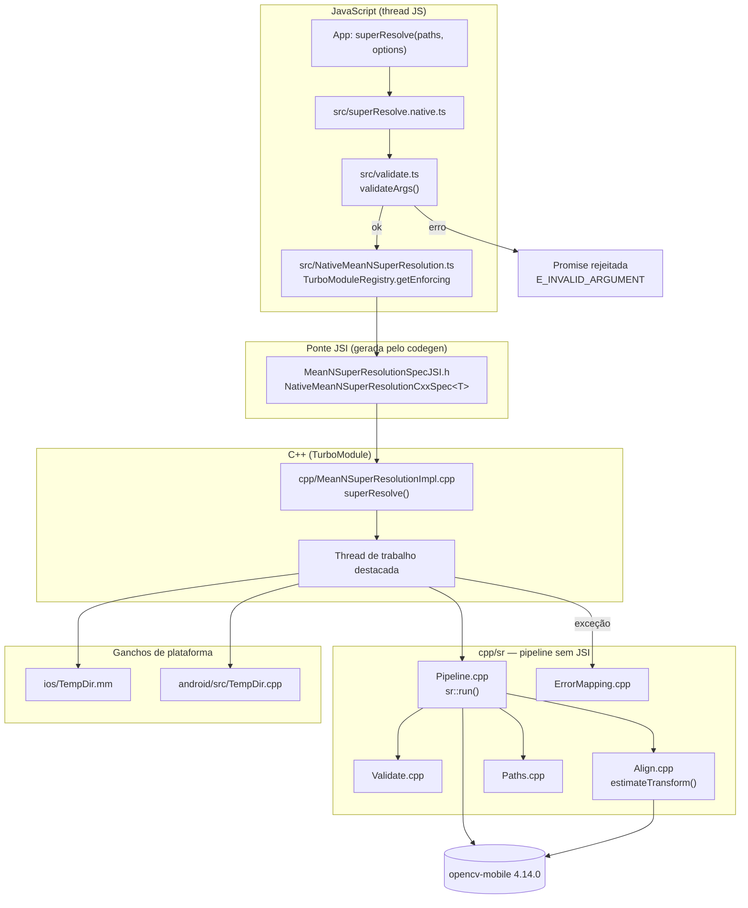

Em resumo:

1. O JS valida os argumentos e rejeita cedo os inválidos.
2. A chamada atravessa a JSI até o adaptador C++, que monta um `sr::Request` e devolve uma Promise imediatamente.
3. Uma thread destacada executa o pipeline: decodifica cada quadro, alinha ao quadro de referência, amplia, acumula, tira a média e grava o resultado.
4. O resultado (ou o erro, no formato `"E_CODIGO: detalhe"`) volta ao JS pela Promise.

### Sequência completa de uma chamada

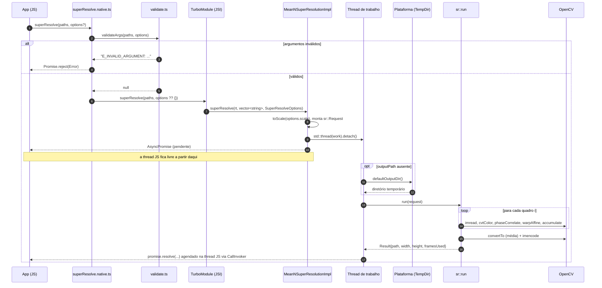

---

## 2. Camada JS

| Arquivo | Papel |
| --- | --- |
| `src/index.tsx` | API pública: reexporta `superResolve`, `ErrorCodes`, `ErrorCode` e os tipos. |
| `src/superResolve.native.ts` | Implementação nativa (Metro escolhe `.native.ts` em iOS/Android). |
| `src/superResolve.ts` | Fallback web: sempre rejeita com "only supported on native platforms". |
| `src/validate.ts` | `validateArgs()` — validação síncrona antes de tocar no nativo. |
| `src/types.ts` | Tipos públicos, mais estritos (`scale?: 1 \| 2 \| 3 \| 4`). |
| `src/NativeMeanNSuperResolution.ts` | Spec do codegen e obtenção do módulo nativo. |
| `src/errors.ts` | Constantes `E_*`. |

### `superResolve.native.ts`

```ts
const error = validateArgs(paths, options);
if (error !== null) return Promise.reject(new Error(error));
return MeanNSuperResolution.superResolve(paths, options ?? {});
```

`options ?? {}` existe porque a spec do codegen declara `options` como obrigatório: o C++ sempre recebe um objeto, com campos opcionais.

### Regras de `validateArgs`

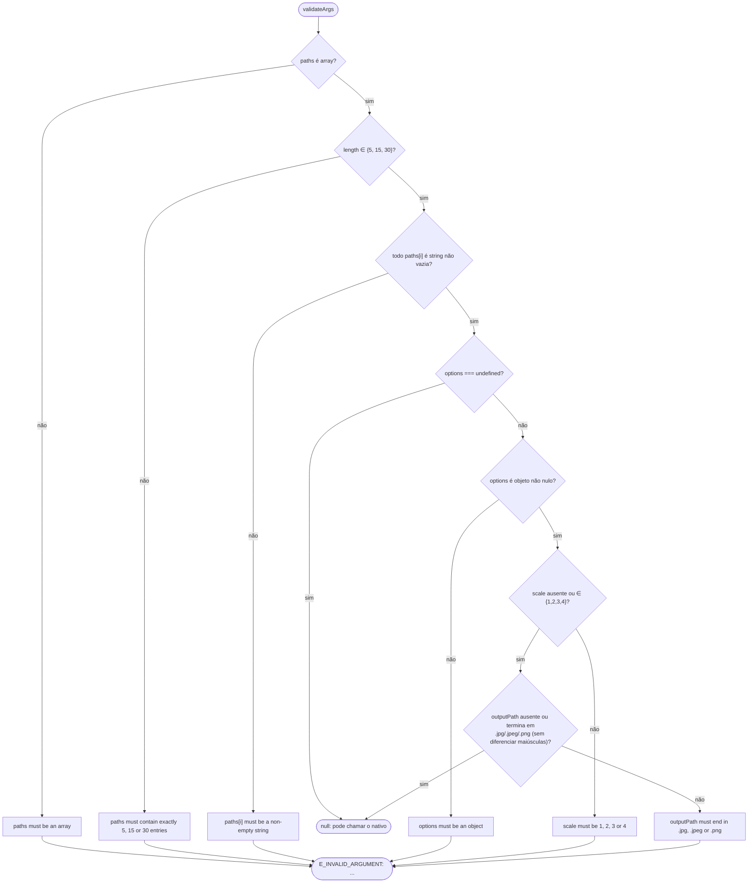

> **Invariante:** essas regras estão duplicadas em `cpp/sr/Validate.cpp`. Quem muda uma precisa mudar a outra. A validação em JS é uma otimização (falha rápida, mensagem clara); a validação em C++ é a garantia, porque o módulo nativo pode ser chamado diretamente.

O JS **não** verifica esquema de URI (`content://`, `ph://`, `http://`). Isso fica a cargo do C++ (`sr::toFsPath`), que também rejeita com `E_INVALID_ARGUMENT`.

---

## 3. Codegen e a ponte JSI

`src/NativeMeanNSuperResolution.ts` é a **fonte do codegen** (`codegenConfig` em `package.json`: `name: MeanNSuperResolutionSpec`, `type: modules`, `jsSrcsDir: src`).

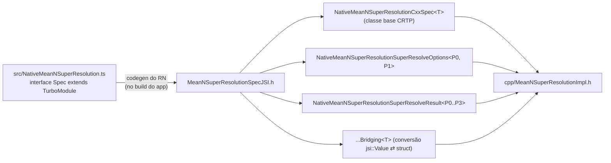

Em `MeanNSuperResolutionImpl.h` os templates gerados são instanciados com tipos concretos:

| TS | C++ |
| --- | --- |
| `paths: string[]` | `std::vector<std::string>` |
| `scale?: number` | `std::optional<double>` |
| `outputPath?: string` | `std::optional<std::string>` |
| `path: string` | `std::string` |
| `width/height/framesUsed: number` | `double` |
| `Promise<SuperResolveResult>` | `AsyncPromise<SuperResolveResult>` |

As especializações `Bridging<SuperResolveOptions>` e `Bridging<SuperResolveResult>` dizem ao React Native como converter entre `jsi::Value` e essas structs. Como a spec gerada é uma classe base com métodos que recebem `jsi::Runtime&` primeiro, **um erro de assinatura aparece como erro de compilação C++**, não como erro de TypeScript.

> Os tipos da spec (`scale?: number`) são mais frouxos que os públicos (`scale?: 1|2|3|4`), porque o codegen não entende união de literais numéricos. Os tipos públicos ficam em `src/types.ts`.

---

## 4. Registro do módulo por plataforma

O módulo é encontrado por nome: `TurboModuleRegistry.getEnforcing<Spec>('MeanNSuperResolution')`. Cada plataforma registra uma fábrica que cria `MeanNSuperResolutionImpl` com o `CallInvoker` do JS.

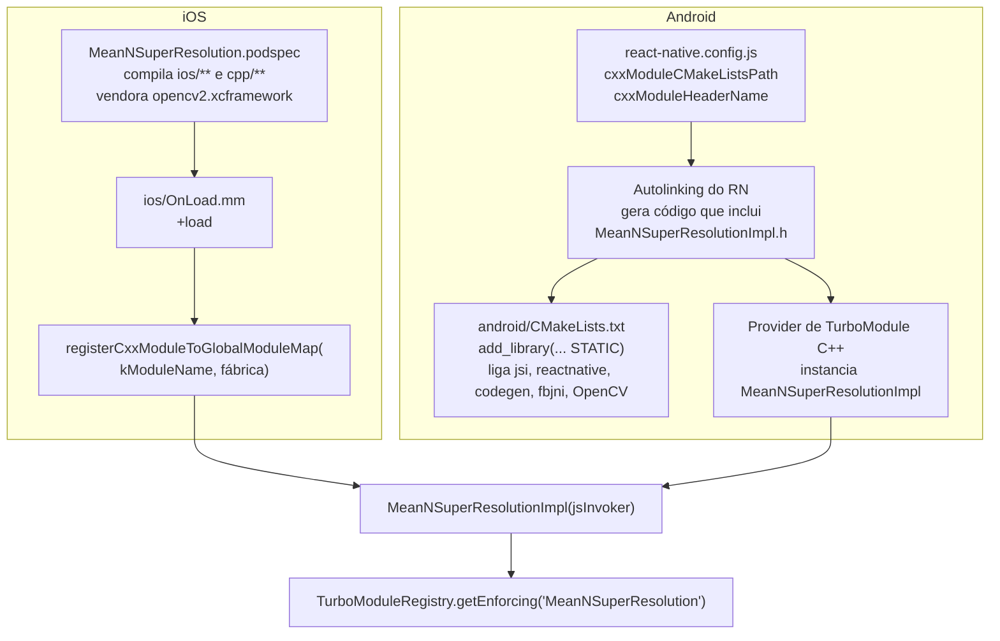

- **iOS:** `+load` roda quando o binário é carregado, antes de qualquer JS. O podspec usa glob, então novos `.cpp` em `cpp/` entram automaticamente (exceto `cpp/tests`, excluído de propósito).
- **Android:** o autolinking lê `react-native.config.js` e adiciona `android/CMakeLists.txt` ao build nativo do app. Novos `.cpp` precisam ser listados manualmente em `add_library`. O CMake falha cedo se o NDK for anterior ao r30 (AD-005), e compila com `-fexceptions -frtti` mesmo que o OpenCV não use exceções, porque o adaptador depende de `catch (...)` e de casar `SrError`.

---

## 5. Adaptador C++ e a thread de trabalho

`cpp/MeanNSuperResolutionImpl.cpp::superResolve` roda **na thread JS** e precisa retornar rápido.

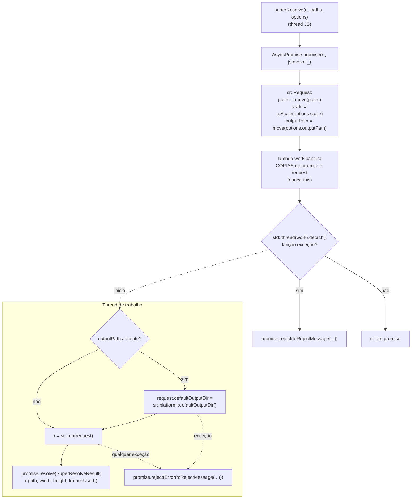

Pontos importantes:

- **`toScale`**: `scale` chega como `double`. Ausente vira `2`. Valores não finitos, não inteiros ou absurdos (|v| > 10⁶) viram `0`, que `sr::validate` rejeita como qualquer valor fora de 1–4. Assim nenhum `double` estranho chega a um `static_cast<int>` com comportamento indefinido.
- **Sem capturar `this`**: o módulo pode ser destruído (por exemplo, no reload do bundle) enquanto a thread trabalha. A lambda só tem cópias de `promise` e `request`.
- **Thread destacada por chamada**: não há fila nem pool. Chamadas concorrentes rodam em paralelo, e cada uma gera um nome de saída único (seção 8).
- **`AsyncPromise`**: `resolve`/`reject` podem ser chamados de qualquer thread; o React Native agenda a liquidação da Promise na thread JS através do `CallInvoker`.
- **`defaultOutputDir()` roda na worker**, não na thread JS, para que um diretório temporário ausente vire uma rejeição (`E_WRITE_FAILED`) e não uma exceção lançada dentro do JS. No Android isso pode exigir JNI, por isso a worker se anexa à JVM (seção 8).

---

## 6. Pipeline de super-resolução (`sr::run`)

`cpp/sr/` não conhece JSI nem React Native. Isso permite testá-lo no host com GoogleTest (AD-003).

### Ideia do algoritmo

É uma super-resolução **multi-quadro por média** ("mean of N"):

1. Pequenos deslocamentos de mão entre fotos de uma rajada fazem cada quadro amostrar a cena em posições de subpixel ligeiramente diferentes.
2. Cada quadro é alinhado ao quadro de referência (`paths[0]`) com uma estimativa de translação de subpixel.
3. Cada quadro é ampliado `scale`× com interpolação bicúbica **já aplicando o deslocamento**, numa única `warpAffine`.
4. A média de todos os quadros aceitos reduz ruído (o ruído aleatório cai aproximadamente com √N) e combina as amostras de subpixel em uma imagem maior.

Com `scale: 1` não há ampliação: o resultado é só alinhamento + média, ou seja, redução de ruído.

### Fluxo

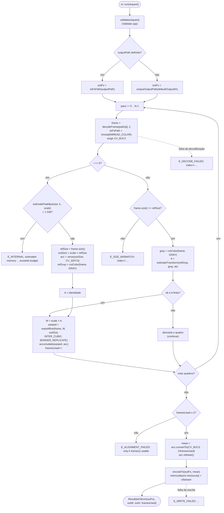

### Detalhes de cada etapa

**Decodificação (`decodeFrame`)**
- `toFsPath` converte `file://` para caminho de sistema (com decodificação de `%XX`) e rejeita outros esquemas.
- `cv::imread(..., IMREAD_COLOR)` sempre entrega 3 canais BGR, converte cinza/alfa e aplica a orientação EXIF.
- Imagem vazia vira `E_DECODE_FAILED` com `index=<i>`. Um tipo diferente de `CV_8UC3` vira `E_INTERNAL`, porque todas as chamadas OpenCV seguintes assumem 8 bits BGR, e uma asserção do OpenCV derrubaria o processo (AD-004).

**Pré-checagem de memória (AD-004)**

Feita depois de decodificar a referência e **antes** de alocar buffers do tamanho da saída:

```
pico ≈ scale² · w · h · (3·4 + 3)   // acumulador CV_32FC3 + um buffer CV_8UC3 do tamanho da saída
     + 3 · w · h                    // quadro decodificado
     + 2 · w · h                    // refGray + gray atual
```

Exemplo, rajada de 12 MP (4000×3000): `scale: 2` estima cerca de 744 MiB e passa. `scale: 3` estima cerca de 1,6 GiB e rejeita com `E_INTERNAL` em vez de esgotar a memória.

**Uso de memória constante em N.** Só um quadro decodificado fica vivo por vez; persistem apenas `refGray` e o acumulador. Por isso 30 quadros não custam mais memória de pico que 5, só mais tempo.

**Warp + upscale numa operação.** `A` é uma afim 2×3 que leva coordenadas do quadro para coordenadas da referência (`[I | −d]` para um deslocamento `d`). Multiplicar por `scale` (`M = s·A`) leva diretamente para coordenadas da saída ampliada:

```
saída(s · (x − d)) = quadro(x)
```

`warpAffine` com `INTER_CUBIC` faz ampliação bicúbica e compensação de subpixel juntas, sem um passo de resize intermediário. `BORDER_REPLICATE` preenche as bordas que ficam sem dados após o deslocamento, repetindo o pixel da borda, para que não entrem pixels pretos na média.

**Acumulação e média.** `cv::accumulate` soma em `float` (`CV_32FC3`), sem saturar em 255. No final, `convertTo(CV_8UC3, 1/framesUsed)` divide, arredonda e satura.

**Referência sempre entra.** O quadro 0 nunca é estimado nem descartado (`A = I`). Por isso `framesUsed ≥ 1` sempre, e a regra "pelo menos 2" significa "a referência e pelo menos um outro quadro alinhado".

**Codificação (`encodeTo`).** O formato vem da extensão em minúsculas (`.jpg`/`.jpeg` com qualidade 95, `.png`). O opencv-mobile casa extensões diferenciando maiúsculas (`.Jpg` falharia em `imwrite`), por isso o código usa `imencode` com a extensão normalizada e grava os bytes com `std::ofstream`. Sem `outputPath`, a saída é sempre JPEG.

**Determinismo.** Não há aleatoriedade no processamento; as mesmas entradas e opções dão bytes idênticos no mesmo dispositivo e build. O único valor aleatório é o `processTag` no nome do arquivo padrão.

---

## 7. Alinhamento (`sr::estimateTransform`)

Arquivo: `cpp/sr/Align.cpp`. O alinhamento é **somente translação**, via correlação de fase. Rotação entre quadros não é compensada.

> **Por que não ECC?** O design original previa `phaseCorrelate` como inicialização e refinamento euclidiano com `findTransformECC`. Mas o opencv-mobile é compilado sem exceções C++: quando o ECC não converge, o `CV_Error(StsNoConv)` **aborta o processo** em vez de lançar exceção. A solução foi ficar só com `phaseCorrelate` e aceitar o quadro com base na correlação no deslocamento estimado.

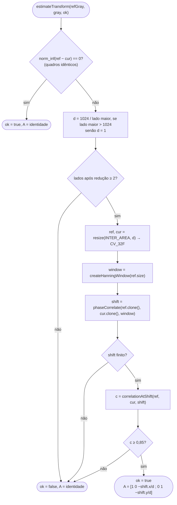

Etapas:

1. **Atalho para quadros idênticos.** Quadros iguais, inclusive totalmente uniformes (onde a correlação não é definida), são aceitos com identidade.
2. **Pirâmide de um nível.** Se o lado maior passa de 1024 px, as duas imagens são reduzidas por `d` com `INTER_AREA`. A FFT fica muito mais barata, e o deslocamento é reescalado no final (`shift / d`).
3. **Guarda contra asserção.** `createHanningWindow`/`phaseCorrelate` têm asserções para lados menores que 2, e uma asserção aborta o processo (AD-004), então isso é checado antes.
4. **`phaseCorrelate`** devolve o deslocamento de subpixel que maximiza a correlação cruzada no domínio da frequência, com janela de Hanning para reduzir efeitos de borda. Ele recebe **cópias**, porque, quando as entradas já têm tamanho ótimo para DFT, ele multiplica a janela nelas no próprio buffer.
5. **Critério de aceitação: `correlationAtShift`.** O quadro atual é deslocado pelo `shift`, e calcula-se a correlação cruzada normalizada (NCC, em [−1, 1]) com a referência só na região de sobreposição válida. Retorna −1 (rejeita) se a sobreposição for menor que 25% da imagem ou se um dos lados não tiver variância. O quadro é aceito com NCC ≥ **0,85**.
6. **Sinal.** Se o conteúdo do quadro se moveu `+shift` em relação à referência, a transformação quadro→referência é a translação `−shift`.

Quadros rejeitados (desfocados, com movimento grande, rotação, cena diferente) só ficam de fora da média e reduzem `framesUsed`; eles não causam erro, a não ser que sobre menos de 2 quadros no total.

---

## 8. Caminhos e diretório de saída

### Conversões (`cpp/sr/Paths.cpp`)

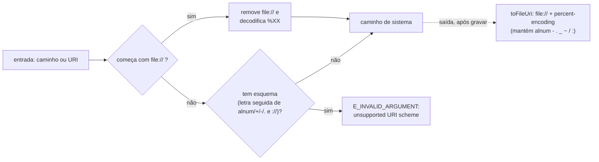

- `lowerExt` é feito com lógica de string pura, de propósito: `std::filesystem` interpreta URIs como `file://C:%5C...` de forma diferente em cada sistema.
- `uniqueOutputPath(dir)` gera `superres-<ms>-<contador>-<processTag>.jpg`. O contador atômico evita colisão entre chamadas concorrentes do mesmo processo; o `processTag` aleatório evita colisão entre processos que compartilham o mesmo diretório temporário.
- O resultado devolvido ao JS é sempre uma URI `file://`.

### Diretório temporário por plataforma (`sr::platform::defaultOutputDir`)

Só é chamado quando `outputPath` não foi passado. Nunca é cacheado: cada chamada resolve de novo.

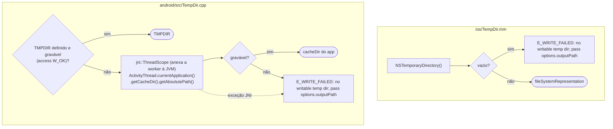

`ActivityThread.currentApplication()` é uma API oculta do Android (greylist). Por isso ela é só o fallback depois de `TMPDIR`, e qualquer falha vira uma mensagem `E_WRITE_FAILED` que orienta a passar `outputPath`.

A biblioteca **nunca apaga** arquivos de saída. O sistema pode limpar esses diretórios a qualquer momento, então o app deve mover ou copiar o que quiser manter.

---

## 9. Erros: do `throw` em C++ ao `reject` em JS

Toda falha conhecida do pipeline é um `sr::SrError` (`cpp/sr/Errors.h`), cujo `what()` já está no formato final `"<CÓDIGO>: <mensagem>"`. A worker captura tudo com `catch (...)` e passa a exceção para `sr::toRejectMessage`.

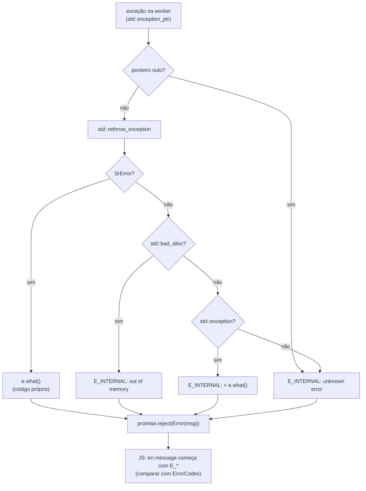

Onde cada código nasce:

| Código | Origem |
| --- | --- |
| `E_INVALID_ARGUMENT` | `src/validate.ts` (antes do nativo), `sr::validate`, `sr::toFsPath` (esquema de URI) |
| `E_DECODE_FAILED` | `decodeFrame` — arquivo ausente ou não decodificável (`index=<i>`) |
| `E_SIZE_MISMATCH` | `sr::run` — quadro com tamanho diferente da referência (`index=<i>`) |
| `E_ALIGNMENT_FAILED` | `sr::run` — `framesUsed < 2` |
| `E_WRITE_FAILED` | `encodeTo`, `defaultOutputDir` |
| `E_INTERNAL` | orçamento de memória, tipo de imagem inesperado, `bad_alloc`, qualquer outra exceção |

`cv::Exception` não aparece no mapeamento de propósito: o opencv-mobile nunca a lança. Um erro interno do OpenCV **encerra o processo**. A defesa é validar toda entrada antes de chamar o OpenCV (tipo `CV_8UC3`, lados ≥ 2, matriz finita, orçamento de memória). Mesmo assim existe um risco residual de crash em casos que essas checagens não previram.

---

## 10. OpenCV: build e restrições

Pacotes pré-compilados do [opencv-mobile](https://github.com/nihui/opencv-mobile), com versão, URL por plataforma e SHA-256 fixados em `opencv.json` (AD-002: OpenCV 4.14.0, release v38).

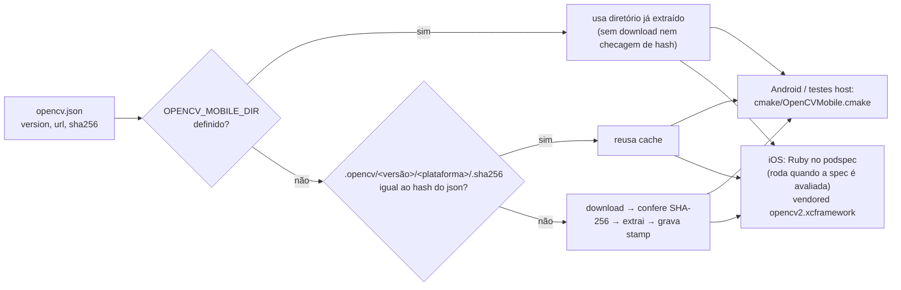

Restrições que moldam o código:

- **Sem exceções (AD-004):** erros do OpenCV abortam o processo. Daí as guardas antes de cada chamada, a pré-checagem de 1 GiB e a troca de ECC por `phaseCorrelate`.
- **Sem `imgcodecs`:** E/S de imagem vem de `<opencv2/highgui.hpp>`. Extensões precisam estar em minúsculas.
- **`phaseCorrelate` modifica as entradas:** recebe cópias.
- **Android NDK r30+ (AD-005):** as libs estáticas v38 referenciam símbolos de libc++/OpenMP que só existem no r30.

---

## 11. Testes

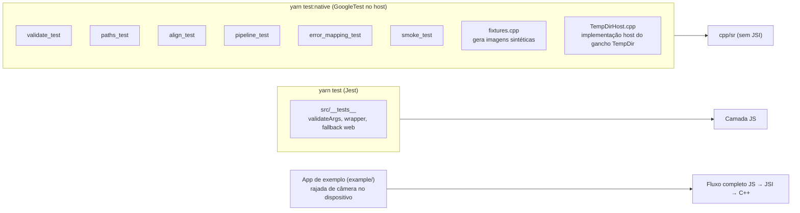

Como `cpp/sr` não depende de JSI, todo o pipeline roda em Windows/macOS/Linux sem emulador. O adaptador JSI (`MeanNSuperResolutionImpl`) e os ganchos de plataforma só são exercitados de ponta a ponta pelo app de exemplo.

---

## 12. Mapa de arquivos

```
src/
  index.tsx                      API pública
  superResolve.native.ts         validação + chamada ao TurboModule
  superResolve.ts                fallback web (rejeita)
  validate.ts                    regras de argumentos (espelho de cpp/sr/Validate.cpp)
  NativeMeanNSuperResolution.ts  spec do codegen
  types.ts / errors.ts           tipos públicos e códigos E_*
cpp/
  MeanNSuperResolutionImpl.{h,cpp}  adaptador TurboModule, thread de trabalho
  platform/TempDir.h                interface do gancho de diretório temporário
  sr/
    Pipeline.{h,cpp}   Request/Result, orçamento de memória, sr::run
    Validate.cpp       sr::validate
    Align.{h,cpp}      estimateTransform (phaseCorrelate + NCC)
    Paths.{h,cpp}      file:// ⇄ caminho, extensão, nome de saída único
    Errors.h           SrError e códigos
    ErrorMapping.{h,cpp}  exceção → "E_CODIGO: detalhe"
  tests/               GoogleTest no host
ios/
  OnLoad.mm            registro do módulo
  TempDir.mm           NSTemporaryDirectory
android/
  CMakeLists.txt       build nativo, checagem de NDK, link do OpenCV
  src/TempDir.cpp      TMPDIR ou cacheDir via JNI
cmake/OpenCVMobile.cmake  download/cache do OpenCV (Android, host)
MeanNSuperResolution.podspec  build iOS + download do OpenCV
react-native.config.js        autolinking C++ no Android
opencv.json                   versão/URL/SHA-256 do opencv-mobile
```

### Checklist para mudar a API

Como descrito no `CLAUDE.md`, mudar `superResolve` significa tocar todas as camadas:

1. `src/NativeMeanNSuperResolution.ts` (spec) e `src/types.ts` (tipos públicos).
2. `src/validate.ts` **e** `cpp/sr/Validate.cpp`.
3. `cpp/MeanNSuperResolutionImpl.{h,cpp}` (assinatura C++ casando com a spec; `Bridging` para structs novas).
4. `cpp/sr/` para a lógica, com testes em `cpp/tests/`.
5. `android/CMakeLists.txt` se houver `.cpp` novo.
6. README (API e erros) e este documento.
